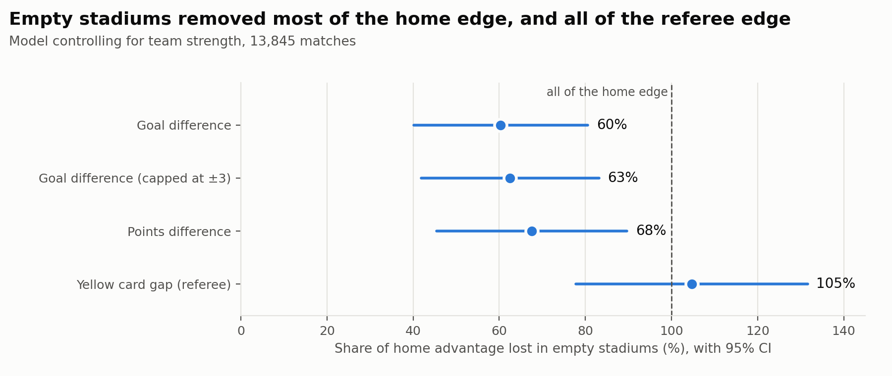
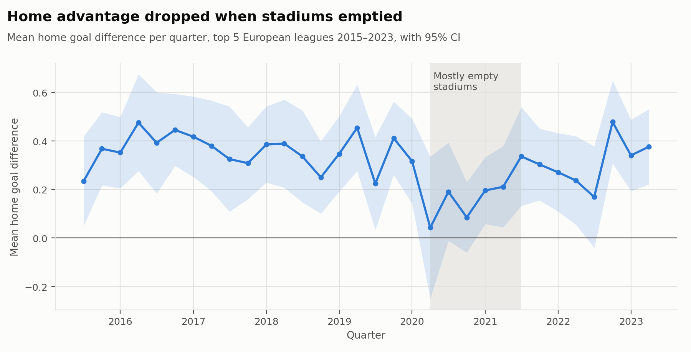
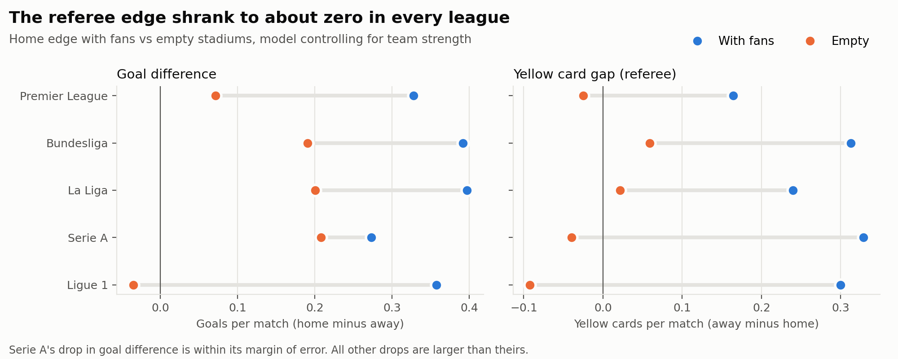
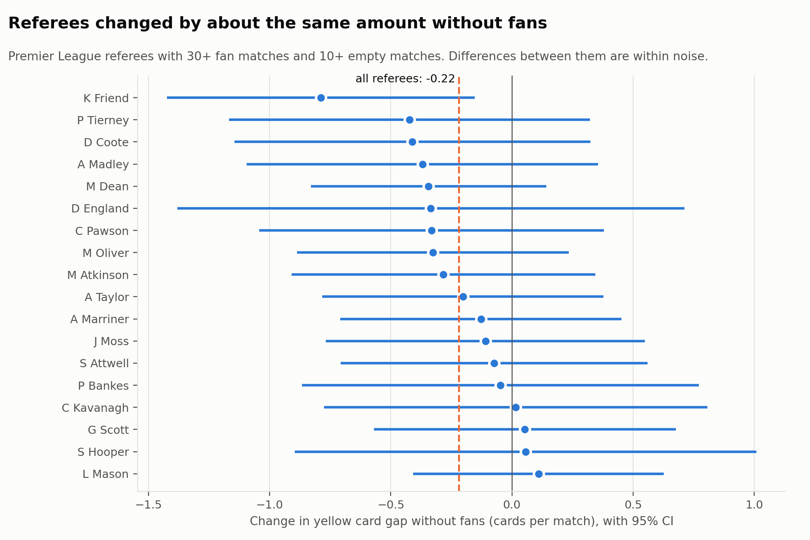

# Ghost Games: What Empty Stadiums Reveal About Home Advantage


## Question
**Do crowds cause home advantage in football? When COVID emptied Europe's stadiums for most of a season, how much of the home edge in goals, points and referee decisions disappeared?**

Nobody can randomly remove crowds from matches, so the pandemic created a rare natural experiment. The same method applies whenever a proper A/B test isn't possible, for example measuring the effect of a price change or a new feature after it has already launched.

## Approach
| Step | Module | Purpose |
|---|---|---|
| 1. Load and validate results from 5 leagues over several seasons | `data.py` | Stop early on duplicates or bad dates |
| 2. Add real attendance from FBref and match team names between the two sources | `attendance.py` | Team names differ between sites, so clubs are matched by their fixture dates |
| 3. Label each match as fans, partial or empty from the real attendance | `treatment.py` | The dates in `config/closed_doors.csv` are only a backup, and are checked against attendance |
| 4. Define outcomes from the home team's view | `outcomes.py` | Goal difference, points difference, card gap, foul gap |
| 5. Compare raw averages with a bootstrap CI and a permutation test | `inference.py` | Is the raw difference real? |
| 6. Regression that controls for team strength | `model.py` | Rules out "stronger teams happened to play at home" |
| 7. Home advantage over time | `model.py` | Does the edge drop in 2020 and come back with the fans? |
| 8. Per-referee changes with shrinkage | `referees.py` | Did some referees change more than others? |
| 9. Compare betting odds with real results | `market.py` | Did the market see the drop? |
| 10. Charts | `figures.py` | The images in this README |

### The model
```
outcome = home_adv + effect·treatment + strength[home team] − strength[away team] + noise
```
Team strength enters as +1 for the home team and −1 for the away team, the same idea as RAPM. This keeps the intercept a clean measure of home advantage.

The treatment is either `closed_doors` (fans vs empty) or `crowd_level` (the crowd as a share of the club's normal attendance, from 0 to 1). The second version also uses the partial-crowd matches, so it answers a sharper question: **does a bigger crowd create a bigger home edge?**

Every measure, equation and modelling choice is explained step by step in [docs/METHODS.md](docs/METHODS.md).

## Results
> **Empty stadiums wiped out about two-thirds of home advantage (60–68%), and the home side's edge in yellow cards disappeared completely.**

14,507 matches from the top five leagues, 2015-16 to 2022-23. "Share lost" is how much of the normal home edge disappeared in empty stadiums, after controlling for team strength.

| Outcome | Share of home edge lost | 95% CI |
|---|---|---|
| Goal difference | 60% | 40–81% |
| Goal difference, capped at ±3 | 63% | – |
| Points difference | 68% | 45–90% |
| Yellow card gap | 105% | 78–132% |



The crowd-size model gives the same picture (54% for goals, 65% for points, 92% for cards), so the result doesn't depend on how a match is labelled.

**Wins moved to the away side, not to draws.** Home wins fell from 45.2% to 39.6% and away wins rose from 29.9% to 34.9%. The draw rate barely moved.



### Referees
The card edge vanished completely. The split shows where the change came from:

| Per match | With fans | Empty |
|---|---|---|
| Home yellows | 1.92 | 1.94 |
| Away yellows | 2.19 | 1.93 |
| Home fouls | 12.43 | 12.75 |
| Away fouls | 12.78 | 12.52 |

Home teams were booked as often as before. **Away teams stopped getting the extra cards.** Home teams actually committed slightly *more* fouls without fans, so calmer home players don't explain it.

Per 100 fouls, away teams got 1.7 more yellow cards than home teams with fans, and only 0.2 more without them (change −1.5, CI −2.0 to −0.9). This fits referees being swayed by the crowd. Caveat: the data can't show how serious each foul was, so different kinds of fouls could explain part of it.



The card edge fell in all five leagues. The goal edge fell everywhere too, but Serie A's drop is within its margin of error.

**No single referee stands out.** 18 Premier League referees had enough matches in both periods (only the Premier League files name the referee). After empirical-Bayes shrinkage (small samples are pulled toward the average), the estimated real spread between referees is zero: they all changed by about the same amount ([results/referees.csv](results/referees.csv)).



### Market check
Bet365 odds were turned into a home-win probability (with the bookmaker's margin removed) and compared with what actually happened.

| Period | Matches | Odds predicted | Actual | Gap | 95% CI |
|---|---|---|---|---|---|
| Fans | 11,822 | 44.5% | 45.2% | +0.7 | −0.1 to +1.5 |
| Empty, first 2 months | 497 | 42.2% | 39.8% | −2.3 | −6.2 to +1.5 |
| Empty, later | 1,525 | 41.9% | 39.5% | −2.4 | −4.6 to 0.0 |

The odds did lower home teams' chances, but not enough: compared with the fans period, the market overrated empty-stadium home teams by about 3 points (CI 0.9 to 5.2). The early sample is too small to say whether the market learned over time. This is a test of how prices absorb new information, not betting advice.

## Threats to validity
- **Other changes at the same time:** five substitutes, a crowded fixture list and a short pre-season. Separating these from the crowd effect is the hardest part.
- **Attendance quality.** FBref leaves attendance blank for some matches. Those fall back to the dates in `config/closed_doors.csv`, and matches with neither are labelled "unknown" and left out.
- **Adaptation:** teams may have adjusted to empty stadiums over the season. The time-series chart shows whether that happened.

## Quickstart
```bash
python -m venv .venv && source .venv/bin/activate
pip install -e ".[dev,analysis]"
pytest -q     # includes a simulation test that recovers a known effect
```

## Roadmap
- [x] Results for E0, D1, SP1, I1 and F1, 2015-16 to 2022-23
- [x] FBref attendance, with team names matched by fixture dates
- [x] Config dates checked against real attendance
- [x] Headline results for fans vs empty and crowd size
- [x] Time-series and league charts
- [x] Referee analysis with shrinkage
- [x] Betting market check
- [ ] Closing odds as a robustness check for the market result
- [ ] Ordered logistic model for win / draw / loss
- [ ] Heterogeneity: did teams with larger stadiums lose more? (needs a capacity dataset)
- [ ] Second tiers, for more empty-stadium matches
